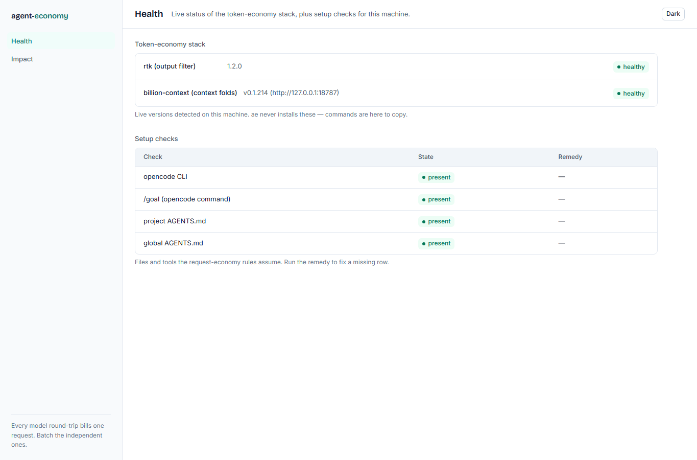
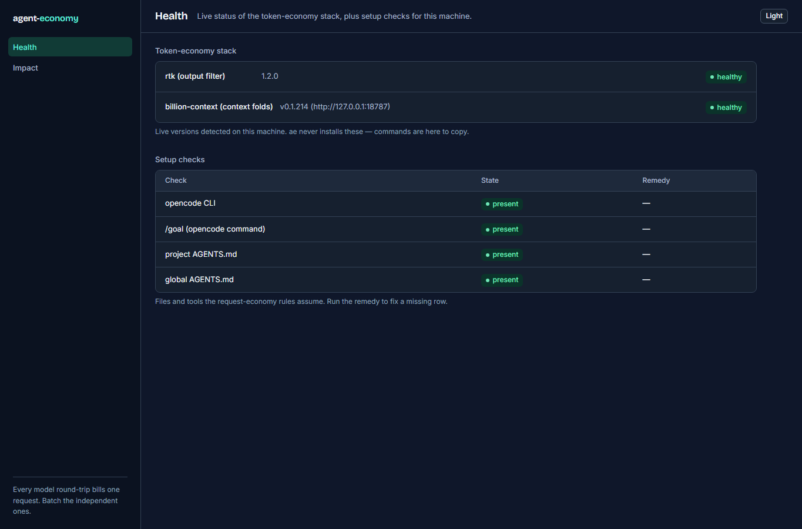

# agent-economy

**Request economy for coding agents.** Free and metered agent tiers bill **per request** — every model round-trip costs one, no matter how small. agent-economy installs a battle-tested rule set that makes agents batch, dedupe, and finish in fewer round-trips — as an idempotent, marker-bounded block in `AGENTS.md`, the open standard every major agent already reads (opencode, Codex, Cursor, Gemini CLI, Jules, Amp, Zed).

```
npm i -g agent-economy        # once per machine (or use npx agent-economy <cmd>)

ae init                       # per project: interactive level + scope
ae init --level strict --yes  # scripted onboarding
ae verify --min-level strict  # CI gate: exit 1 missing, 2 below level
ae doctor                     # stack (rtk / billion-context, with live health) + setup checks
ae ui                         # local dashboard: health + impact
```

### Install with your agent (no terminal needed)

Paste this into opencode / Claude Code / Codex / Cursor — the agent does the rest:

> Install agent-economy: run `npx -y agent-economy@latest init --level standard --yes`, then `npx -y agent-economy@latest skill`, then `npx -y agent-economy@latest doctor`, and report the results. Don't ask clarifying questions; project scope.

After that, every future session discovers the `agent-economy-setup` skill and knows how to verify, re-configure, or extend the setup on its own.

## Why requests, not tokens

Token-compression tools (billion-context, RTK, headroom) are plentiful. **Request-economy tooling does not exist** — yet per-request metering is what actually caps free-tier sessions (measured baseline: ~7 model requests per user message in a real opencode session). Batching 3 independent calls into 1 round saves 2 requests *and* 2 round-trips of latency, every time. No plugin can force batching — call count is decided at generation time — so the prompt is the only injection point. This project owns that injection point.

## The dashboard (`ae ui`)

```bash
ae ui        # → http://127.0.0.1:4747 (Ctrl+C to stop)
```

A local, read-only control room for your token-economy stack: live tool health, and **Impact** — real savings counters read from the stack itself (`rtk gain --format json`, the billion-context proxy's `/__bili/stats`): commands filtered, tokens saved, requests served, cache-hit %. With **copyable commands instead of install buttons** (the tool manages rules; it never mutates your runtime). Node stdlib only, no dependencies, dark and light themes.




## Levels

| Level | Rules |
|---|---|
| `standard` | parallel independent calls · batch related shell commands (max ~5) · never re-run for known info · filter large output at the source |
| `strict` | standard **+** assume-and-proceed instead of clarifying questions · same-turn completion · no subagents for small lookups |
| `off` | removes the block (clean uninstall) |

## Mechanics

- **Idempotent** — blocks are wrapped in `<!-- agent-economy:start level=… -->` … `<!-- agent-economy:end -->`; re-running updates in place, never duplicates
- **Backup first** — `AGENTS.md.bak-<timestamp>` before any change
- **Zero dependencies** — Node stdlib only; runs anywhere Node ≥ 18 runs
- **Zero runtime cost** — the CLI runs once at setup; the artifact is the file. No plugin, no MCP, no per-session overhead

## Enforce it in CI

You can't police teammates' machines — you can police the repo:

```yaml
# .github/workflows/agents-md.yml
- run: npx agent-economy verify --min-level strict
```

## Development

```bash
npm test                              # hermetic node:test suite
git config core.hooksPath .githooks   # pre-commit verify (one-time per clone)
```

Releases: push a tag (`git tag vX.Y.Z && git push --tags`) — the `release` workflow runs the tests, then publishes to npm via **OIDC trusted publishing** (no token secret). One-time setup on npmjs.com: package → Settings → Trusted Publisher → `markymakes-dev/agent-economy` · workflow `release.yml`. Known upstream blocker: GitHub repos created after 2026-07-15 force immutable OIDC subject claims, which npm's token exchange rejects until [npm/cli#9969](https://github.com/npm/cli/issues/9969) is fixed — until then, publish manually from the repo root (`npm publish`).

## Scope

agent-economy deliberately does **one thing**: manage the request-economy rules as an artifact and prove their effect. It does not curate or install third-party skills (use `npx skills add <repo>` for that), and it does not inventory your agent config. RTK and billion-context are **runtime tools**, not content — `ae doctor` shows whether they're alive and prints their setup commands; `ae` never installs them for you (see [ADR-0001](docs/adr/0001-rules-artifact-only.md)).

## Positioning

Token compressors optimize **bytes**; this optimizes **round-trips**. Different unit, different layer, complementary stack. The dedicated AGENTS.md-template niche is empty (existing repos: 6–41★) while the adjacent skills ecosystem measures in six figures — the lane is open.

## License

MIT
